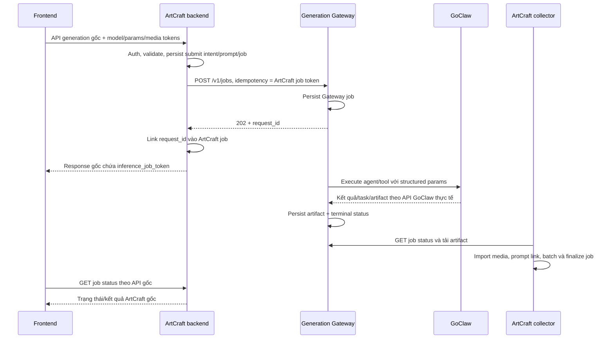

# Hướng dẫn 09: Tích hợp generation service riêng vào backend ArtCraft

## 1. Mục đích và trạng thái

Tài liệu này là hợp đồng tích hợp và trình tự thực hiện chung cho:

- [Plan 07 — chỉnh sửa backend ArtCraft](07-generation-gateway-and-goclaw-reuse-plan.md).
- [Plan 08 — implement Generation Gateway](08-generation-gateway-service-plan.md).
- [Plan 10 — frontend](10-generation-gateway-frontend-plan.md).

**Các endpoint Gateway, biến cấu hình và DTO trong tài liệu là thiết kế cần implement, chưa phải chức năng đã có sẵn.** Không chỉ đổi URL rồi kỳ vọng code hiện tại tự hoạt động.

Giữ nguyên API public ArtCraft. Frontend vẫn gọi `/v1/omni_gen/*`, `/v1/omni_api/*`, job/media và các route chuyên biệt hiện hữu. Service mới chỉ là đích gọi nội bộ của backend/client/collector.

Trong lượt tách kế hoạch này không sửa source, tạo service/config runtime hoặc chạy/build/test/deploy repo.

## 2. Trách nhiệm hai bên

- **Backend ArtCraft:** authentication người dùng, permission/owner/visibility, validate public request, model/capability adapter, resolve input media, lưu ArtCraft job/prompt/context, trả public job token.
- **Client phía ArtCraft:** gửi HTTP có authentication tới Gateway, serialize đúng DTO version, timeout/retry có idempotency, chuyển lỗi nội bộ về error contract ArtCraft.
- **Gateway:** validate capability, persist/execute task GoClaw, giữ trạng thái và artifact.
- **ArtCraft collector:** poll Gateway, tải artifact có auth, import/finalize vào database/storage ArtCraft, cập nhật trạng thái gốc.
- **Frontend:** giữ model picker/tham số/job polling/UI; không biết Gateway token hoặc GoClaw token.



Thư viện client không có port/server. Gateway và ArtCraft collector là thành phần vận hành riêng. Executor GoClaw nằm phía Gateway.

**Định danh và wake:** ArtCraft job token liên kết với Gateway job ID do service tự tạo và persist trước khi trả `202`. Worker Gateway gọi GoClaw wake theo kiểu đồng bộ; `run_id` GoClaw chỉ có trong response sau khi agent run hoàn tất, không phải Gateway job ID hoặc acknowledgement enqueue. ArtCraft collector poll Gateway, không mặc định poll wake. Chi tiết timeout, retry, media và nguồn upstream nằm trong [nghiên cứu API wake](12-goclaw-wake-api-research.md); Gateway idempotency không tự đảm bảo wake thực thi exactly-once.

## 3. Contract nội bộ v1 dùng chung

Đây là nguồn quy ước chung. Plan 08 implement contracts/service; plan 07 dùng cùng contracts cho client/collector. Nếu cần điều chỉnh thiết kế, cập nhật cả hai phía trước implementation; không tạo hai schema cùng tên nhưng khác semantics.

### 3.1. Header và API

Mọi request service-to-service dùng:

```http
Authorization: Bearer <GENERATION_GATEWAY_TOKEN>
Content-Type: application/json
```

Không chuyển cookie/session/API key người dùng hoặc token GoClaw vào header này.

- `GET /v1/models`: registry model/capability thực tế.
- `POST /v1/jobs`: submit một operation, trả `202 Accepted`.
- `GET /v1/jobs/{request_id}`: lấy status/error/manifest.
- `GET /v1/jobs/{request_id}/artifacts/{artifact_id}`: stream artifact.
- `POST /v1/jobs/{request_id}/cancel`: yêu cầu hủy best-effort.

Segmentation session/mask và character lifecycle cần DTO operation riêng trong contracts. Với operation đồng bộ mà public caller yêu cầu, backend adapter giữ response đồng bộ tương thích bằng cơ chế session/status phù hợp và timeout hữu hạn; không tự đổi public response thành job token.

### 3.2. Submit request

Ví dụ minh họa một job ảnh:

```json
{
  "schema_version": 1,
  "idempotency_key": "jinf_example",
  "operation": "image.generate",
  "model": "flux_1_dev",
  "prompt": "Một ngôi nhà cạnh hồ",
  "parameters": {
    "aspect_ratio": "square",
    "image_batch_count": 1
  },
  "inputs": [],
  "metadata": {
    "artcraft_job_token": "jinf_example",
    "correlation_id": "generation-example"
  }
}
```

`jinf_example` chỉ là placeholder. Backend dùng job token thật do hệ thống ArtCraft tạo, không dùng literal này.

- `schema_version`: version nội bộ, không phải API version ArtCraft.
- `operation`: phân biệt image/video/audio/mesh/splat/edit/inpaint/VFX/workflow...; typed DTO cụ thể trong contracts.
- `model`: ID mà API ArtCraft đã nhận, phải có mapping và đúng model thực thi.
- `parameters`: tham số của operation đã được bảo toàn/chuẩn hóa; các trường required/optional/default được khai báo theo schema.
- `inputs`: danh sách có role như image_reference/mask/start_frame/end_frame/audio_reference/multi_view_front/character.
- Mỗi input có trusted URL hoặc service artifact reference và MIME/metadata cần thiết. Không gửi URL provider tùy ý từ frontend qua thẳng service.
- `metadata` chỉ để đối chiếu; service không dựa vào user ID tự khai báo để quyết định quyền ArtCraft.
- Cùng idempotency key và cùng request hash trả cùng request ID; khác payload cùng key bị từ chối. Điều này áp dụng cả khi submit ban đầu timeout.
- Service phải xác nhận đúng model/capability trước nhận job. Ví dụ Flux chỉ hợp lệ nếu GoClaw/tool thực sự có Flux, không phải nhãn thay cho một model khác.

### 3.3. Submit response và status

Submit thành công:

```json
{
  "schema_version": 1,
  "request_id": "gw_example",
  "status": "queued"
}
```

Status thành công sau thực thi:

```json
{
  "schema_version": 1,
  "request_id": "gw_example",
  "status": "succeeded",
  "artifacts": [
    {
      "artifact_id": "output-0",
      "role": "primary",
      "media_class": "image",
      "content_type": "image/png",
      "size_bytes": 12345,
      "batch_index": 0
    }
  ],
  "error": null
}
```

Ví dụ chỉ thể hiện phần cốt lõi. Contracts phải định nghĩa đủ metadata/relations cho audio multi-clip, video, mesh texture/cover, splat, character và mask.

Trạng thái Gateway: `queued`, `running`, `succeeded`, `failed`, `cancelled`. Progress nếu có là dữ liệu thật, optional, không tự tăng theo timer.

Artifact được tải theo request ID + artifact ID, không cần cho browser thấy địa chỉ service. Gateway chỉ báo succeeded khi output bắt buộc đã lưu bền vững và có thể tải.

### 3.4. Error nội bộ và ánh xạ ra API gốc

Error nội bộ có version, code ổn định, message an toàn và khả năng retry. Không đưa traceback, token hoặc prompt/context không cần thiết vào lỗi.

- Request public ArtCraft sai: backend tiếp tục trả error/status như API gốc trước khi gọi service.
- Gateway báo unsupported/invalid parameter: adapter chuyển về error envelope public hiện có; không thêm schema lỗi mới hoặc mở modal mua credit.
- Gateway credential/network lỗi: đây là lỗi tích hợp phía server, không báo người dùng ArtCraft bị logout hoặc thiếu subscription.
- Job đã được nhận rồi thất bại: collector ghi failure vào ArtCraft job, không biến status poll thành response lỗi provider thô.
- Gateway state/DTO mới không lộ trực tiếp ra frontend. Unknown state/version phải bị xử lý có chủ đích và được log bằng correlation ID.

## 4. Cấu hình để backend gọi đúng service

Tên biến dưới đây là quy ước đề xuất cần được đọc trong implementation; chưa tồn tại đầy đủ trong source hiện tại.

### 4.1. Backend ArtCraft và collector

```dotenv
GENERATION_EXECUTION_MODE=gateway
GENERATION_GATEWAY_BASE_URL=http://generation-gateway:8090
GENERATION_GATEWAY_TOKEN_FILE=/run/secrets/generation_gateway_token
```

- Cả backend và collector dùng cùng service URL/token.
- Secret file chỉ chứa Gateway token. ArtCraft không cần token GoClaw.
- Chế độ gateway route mọi execution AI thuộc phạm vi đã chuyển qua client mới; không fallback provider cũ.
- Self-host pricing policy bỏ credit/subscription gate ArtCraft nhưng giữ auth/permission/rate/concurrency.
- Client request timeout dành cho submit/status/download; không giữ HTTP request frontend mở để chờ toàn bộ task GoClaw.

### 4.2. Service Gateway

Service ở repo riêng có frontend quản trị đơn giản để cập nhật kết nối GoClaw và mapping model/operation/agent theo mục 5 Plan 08. Đây là UI quản trị service, không phải Settings trong frontend ArtCraft. Skills quản lý trực tiếp bên GoClaw; ArtCraft chỉ cần URL/token Gateway như mục 4.1.

Ví dụ cấu trúc config đề xuất, không phải file runtime đã tạo:

```json
{
  "listen": "0.0.0.0:8090",
  "gateway_token_file": "/run/secrets/generation_gateway_token",
  "goclaw": {
    "url": "https://goclaw.example.com",
    "token_file": "/run/secrets/goclaw_api_token"
  },
  "models": [
    {
      "model": "flux_1_dev",
      "operation": "image.generate",
      "agent_id": "your-image-agent",
      "supported_parameters": ["aspect_ratio", "image_batch_count"]
    }
  ]
}
```

Đây là một entry minh họa. File thật cần registry cho đủ modality đang dùng và đầy đủ range/default/input/output theo plan 08. Không mặc định model trong ví dụ đã được GoClaw hỗ trợ.

Service giữ token GoClaw khác Gateway token. Job store/artifact store có secret riêng. Config thật gitignore hoặc nằm secret store; không đóng vào frontend bundle/image công khai.

Config GoClaw cũ của implementation trực tiếp không có đầy đủ mapping model/operation/capability này; cần chuyển dữ liệu có chủ đích, không chỉ đổi tên biến môi trường.

Ví dụ file trên dùng cho bootstrap/import phía server. Khi bật cấu hình qua admin UI, database service lưu revision là nguồn chính cho URL/mapping; credential dùng kho mã hóa phía backend với khóa ngoài database. Không tự import lại file mẫu mỗi lần startup để ghi đè thay đổi admin. Secret triển khai, khóa mã hóa và admin bootstrap vẫn lấy từ secret/env; không đưa vào UI response/export.

Frontend quản trị ưu tiên cùng origin với service và có admin session riêng; Gateway token dùng cho ArtCraft không được nhúng vào frontend này. UI chỉ gửi token GoClaw khi admin thay token, backend không trả lại token đã lưu. Cấu hình mới chỉ áp dụng cho job mới; không tự chạy wake trong thao tác lưu/kiểm tra kết nối.

### 4.3. Network

- Cùng Docker network: backend/collector gọi `http://generation-gateway:8090` theo service DNS.
- Khác máy: cấu hình private DNS/VPN hoặc HTTPS endpoint có TLS/auth phù hợp.
- `localhost` trong container là container đó; không dùng nó để chỉ container service khác. Backend container gọi service chạy trên host cần địa chỉ host phù hợp với môi trường.
- Gateway phải truy cập được GoClaw và input media. Collector phải truy cập được Gateway/artifact và storage ArtCraft.
- Cho phép private endpoint đã cấu hình rõ; vẫn kiểm tra input URL/redirect để không mở outbound tùy ý.
- Frontend ArtCraft không cần CORS Gateway và tiếp tục gọi API ArtCraft; API host không đổi thành URL Gateway. Frontend quản trị service ưu tiên cùng origin với admin API; nếu khác origin thì chỉ allowlist origin quản trị đã cấu hình.

### 4.4. Google login và session self-host

Google login giữ luồng: browser nhận ID token Google → backend ArtCraft xác minh qua `/v1/accounts/google_sso` → database tự host tạo/tìm tài khoản → backend cấp session ArtCraft. Gateway/GoClaw không nhận token Google hoặc cookie người dùng.

Cấu hình hai phía:

```dotenv
# Frontend: biến đã có, được Vite đọc khi chuẩn bị bundle
VITE_GOOGLE_CLIENT_ID=YOUR_CLIENT_ID.apps.googleusercontent.com

# Backend: biến đề xuất, cần implement ở verifier/startup
GOOGLE_SIGN_IN_ALLOWED_AUDIENCES=YOUR_CLIENT_ID.apps.googleusercontent.com
```

- Tạo/quản lý OAuth client dành cho web và cấu hình consent/audience của ứng dụng Google; đăng ký origin frontend thực tế gồm scheme/host/port cho từng môi trường. Nếu ứng dụng Google đang ở chế độ thử nghiệm, cấu hình người dùng thử tương ứng.
- Luồng hiện tại nhận ID token qua Google button callback trong browser, không có OAuth redirect callback backend mới cần tự thêm. Chỉ cấu hình redirect URI nếu sau này thực sự dùng luồng redirect.
- Client ID không phải secret. Không cần thêm client secret vào frontend hoặc generation service cho luồng ID token hiện có.
- Backend nạp danh sách audience phân cách bằng dấu phẩy, loại khoảng trắng và từ chối danh sách rỗng khi bật Google login. Frontend client ID phải thuộc danh sách; không giữ ID cũ như fallback ngầm.
- Cấu hình API host và CORS cho origin frontend, cho phép credentials đúng cơ chế hiện hữu. Cookie domain/path/Secure/SameSite phải phù hợp topology triển khai; không mặc định một cookie domain dùng được cho mọi cặp domain. Với frontend/backend khác site, cần đánh giá thêm giới hạn cookie của browser hoặc dùng topology cùng site.
- Tài khoản Google liên kết và session lưu trong database/store deployment tự host. Cùng email Google không tự chuyển tài khoản/media từ database Storyteller.

Phân công: Plan 07 sửa backend verifier/startup/config deploy; Plan 10 sửa cấu hình frontend và caller nếu cần. Task tích hợp/người vận hành quản lý OAuth client trên Google và các giá trị domain/client ID. Plan 08 không đổi authentication để phục vụ login người dùng.

Nghiệm thu sau khi được phép chạy: đăng nhập/đăng ký mới, đăng nhập lại, session còn hợp lệ khi reload/gọi API generation, logout và từ chối token sai audience/issuer/hết hạn/chữ ký sai. Xác nhận tài khoản mới và session thuộc deployment tự host; không ghi token vào log và không gửi sang Gateway.

## 5. Nối code backend vào service theo thứ tự

1. Import contracts và thêm `generation_gateway_client` dưới `re-implement`.
2. Nạp Gateway URL/token và execution policy trong startup; không khởi tạo credential AI cũ bắt buộc nếu mode gateway không dùng chúng.
3. Thêm execution provider/adapter ở router. Chuyển request chuẩn hóa sang DTO Gateway trước khi bị biến thành payload Fal/Kinovi.
4. Giữ public validation/auth, lookup media và role tham chiếu. API key có URL input vẫn ingest/validate thành media thuộc owner theo luồng gốc.
5. Tạo durable submit intent và ArtCraft job token, lưu prompt/context/request hash theo policy của backend.
6. Gọi `POST /v1/jobs` với idempotency key là ArtCraft job token. Thả DB connection trước network I/O.
7. Liên kết Gateway request ID vào job, trả response ArtCraft gốc với `inference_job_token` và batch/all_job_tokens theo semantics từng endpoint.
8. Nếu timeout ở bước submit, reconcile bằng cùng key; không tạo key mới và không đốt token khiến không thể khôi phục.
9. Collector lấy Gateway job chưa terminal, poll status và tải artifact khi succeeded.
10. Import file theo media type thật, ghi metadata/prompt/source job/batch/owner/visibility, xử lý output phụ và finalize.
11. Frontend tiếp tục poll `/v1/jobs/job/{token}` hoặc omni-api job status. Gateway succeeded chưa được đổi thành ArtCraft complete trước khi import thành công.
12. Terminate/cancel/dismiss API giữ semantics cũ; nếu tool không hủy được phải xử lý kết quả muộn và không tuyên bố sai.

Với character/segmentation/workflow: thêm adapter theo contract riêng từng route. Không ép mọi operation trả hình dạng một ảnh hoặc job response giống nhau.

## 6. Nhận kết quả và tránh job lỗi/trùng

- Collector claim bằng lease/lock, retry có backoff; terminal update và media linkage phải idempotent.
- Mapping ArtCraft job token ↔ Gateway request ID được persist; không chỉ giữ trong RAM.
- Download/validate artifact ngoài transaction. Finalization ghi database ngắn, có cách xử lý upload dở và orphan.
- Giữ thứ tự batch và toàn bộ clip/file cần thiết; public `all_job_tokens` không được mất hoặc tự thêm sai số job.
- Giữ metadata duration/dimensions, cover/texture và định dạng GLB/OBJ/splat, không chỉ PNG/MP4.
- Input signed URL phải sống đủ lâu hoặc có cơ chế refresh/upload; không buộc công khai file private.
- Artifact TTL lớn hơn cửa sổ chờ/import/retry đã thống nhất; chỉ cleanup khi hết retention hoặc có cơ chế xác nhận import.
- Thumbnail/video processing của ArtCraft vẫn phải được vận hành; lưu video gốc không sinh thumbnail tự động.
- Polling là mặc định. Nếu thêm callback, cần auth/chữ ký/replay protection và reconcile race với database commit, không dùng webhook Fal như một giao thức giả.

## 7. Tích hợp catalogue và frontend với thay đổi tối thiểu

Đây là checklist ghép, không phải task sửa frontend trong Plan 07. Agent Plan 10 sở hữu toàn bộ file `frontend/`; agent Plan 07 sửa backend và bàn giao contract. Plan 08 sở hữu contracts/service, không sửa client/collector của Plan 07. Các agent có thể viết code song song dựa trên API public giữ nguyên và contract nội bộ tại mục 3; nghiệm thu tích hợp cần các bên sẵn sàng và được phép chạy.

- Backend ánh xạ catalogue model/capability hiện có với registry Gateway, giữ schema/default/limit và model ID đúng thực thi.
- Restore các caller đã chuyển sang endpoint GoClaw riêng về API generation/job gốc.
- Không thêm agent picker, secret input hoặc Settings GoClaw; UI giữ các model controls cũ theo capability.
- Không redesign hoặc tự bật PageScene/inpaint web/deprecated chỉ vì có service mới.
- Bỏ chặn pricing/subscription/credit đã yêu cầu; API cost giữ schema và phản ánh chính sách không thu credit ArtCraft.
- Direct segmentation giữ path/method/request/response hiện hữu khi thay host sang adapter của mình.
- Không thay `StorytellerApiHostStore` thành host service. Gateway route/data là chi tiết nội bộ phía backend.

## 8. Trình tự ghép và rollout

1. Plan 07/08 thống nhất contract nội bộ examples/version và ma trận operation trước khi implement; Plan 10 dùng API public ArtCraft giữ nguyên và nhận bàn giao catalogue/cost/job/segmentation. Phân quyền file theo mục 2 Plan 10 để tránh sửa trùng.
2. Plan 08 cung cấp contracts/service và cấu hình mẫu; plan 07 cung cấp client/collector/dispatch adapter tương thích.
3. Chuẩn bị Gateway job/artifact persistence, secret và network; không sử dụng placeholder như credential thật.
4. Chuẩn bị backend/collector cùng config và binary hiểu job type mới.
5. Sau khi được phép chạy, kiểm chứng service readiness/model capability, sau đó request generation qua API ArtCraft nguyên bản.
6. Mở gateway mode theo phạm vi đã kiểm kê. Mỗi route phải qua service hoặc báo unsupported bằng cơ chế hiện hữu; không còn đường bypass âm thầm.
7. Giữ provider worker/webhook cũ cho job đang tồn. Không chuyển một job Fal đã gửi dở thành một GoClaw job mới.
8. Khi drain xong, gỡ execution path trực tiếp GoClaw và secret/provider không dùng; giữ decode lịch sử cần thiết.
9. Rollback có thể đổi routing cho job mới nhưng vẫn phải có collector/binary xử lý job gateway đang chạy. Không rollback về binary không hiểu dữ liệu mới khi chưa có kế hoạch tương thích.

Không có lệnh run/build/deploy được thực thi trong tài liệu này; các bước vận hành chỉ thực hiện khi chủ repo cho phép.

## 9. Ma trận nghiệm thu tích hợp

- [ ] Image/video/audio/mesh/splat: request params/default/limits, reference và output đúng.
- [ ] Edit/inpaint/angle/removal/VFX: mask/role/media type và endpoint contract được giữ.
- [ ] API-key image/video và URL input hoạt động như session endpoints trong phạm vi quyền tương ứng.
- [ ] Character/session segmentation/workflow có kết quả kiểm kê; các stub cũ không bị quảng bá là đã hoạt động.
- [ ] Minimax branch và các route theo model không bypass gateway mode.
- [ ] Không có secret GoClaw/Gateway xuống browser hoặc log.
- [ ] Google OAuth client/origin do mình quản lý; frontend client ID khớp audience cấu hình backend, không còn ID cũ hardcode/fallback. Login/session/logout và token không hợp lệ có kết quả nghiệm thu khi được phép chạy.
- [ ] Không còn request AI đã chuyển đi trực tiếp tới provider cũ từ frontend/backend.
- [ ] Không chặn generation bởi credit/pricing/subscription ArtCraft.
- [ ] Public status/error/job token/batch response không đổi.
- [ ] Callback/poll/retry/restart/import failure không tạo job hoặc media trùng.
- [ ] Artifact auth/retention/ownership/visibility và file giới hạn được áp dụng.
- [ ] Gallery/history/recreate/lightbox/thumbnail hoạt động qua media pipeline gốc.
- [ ] Diff UI chỉ có điểm nối bắt buộc và pricing gate; không redesign.
- [ ] Worker job tồn, rollback và cleanup có quy trình rõ.
- [ ] Chỉ ghi nhận runtime passed khi đã được phép và thực sự thực hiện; hiện chưa chạy/build/test/deploy repo.

**Đầu ra cuối:** frontend tiếp tục gọi cùng API ArtCraft; backend thực thi AI qua client/service do mình quản lý; chỉ service giao việc cho GoClaw.
