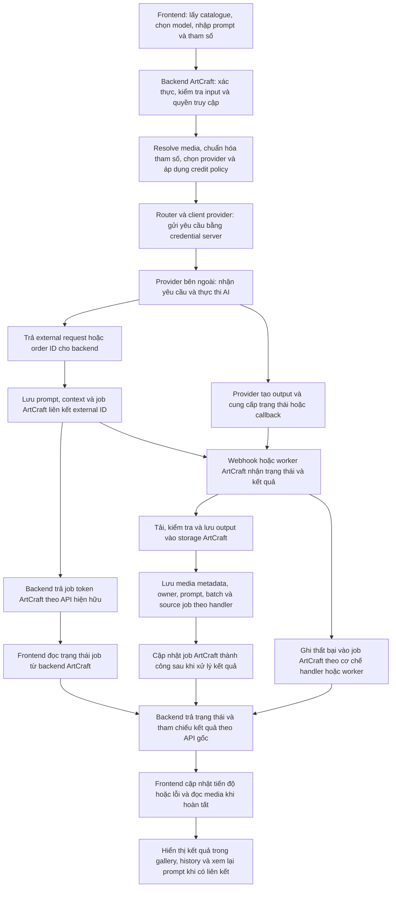
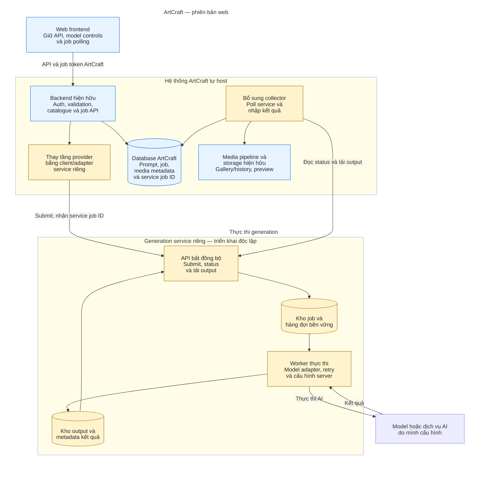

# Tổng quan phương án tự quản lý Generation Service cho ArtCraft

## 1. Mục tiêu

**Phạm vi: phiên bản web ArtCraft và backend/service phục vụ phiên bản web. Không bao gồm ứng dụng desktop, Tauri/native integration, đóng gói hoặc phát hành desktop. Toàn bộ phạm vi công việc và ước tính thời gian trong báo cáo chỉ áp dụng cho phiên bản web.**

Giữ nền tảng ArtCraft đã self-host và trải nghiệm tạo nội dung hiện có; chuyển phần thực thi AI sang **generation service riêng do mình quản lý**. Đồng thời bỏ cơ chế giá, credit và subscription ArtCraft đối với generation trong bản self-host.

Phạm vi gồm ảnh, video, âm thanh, mô hình 3D, splat/world và các chức năng AI liên quan như chỉnh sửa, VFX, character, segmentation và workflow đang được sử dụng.

Tài liệu trình bày luồng generation hiện hữu, kiến trúc đề xuất và phạm vi chuyển đổi sang hệ thống AI do mình quản lý.

## 2. Luồng generation trong ArtCraft gốc

Phần này mô tả source repo gốc `storytold/artcraft-services` tại commit `e57ee3d63ac478a24149384bf1473ef97aa067f8`. Luồng gốc được trình bày đầy đủ dưới đây; mục 3 thể hiện ranh giới kiến trúc ArtCraft và generation service riêng, cùng các phần cần thay đổi.

### Trình tự xử lý đầy đủ

1. **Nhận yêu cầu:** frontend lấy catalogue/capability từ backend rồi gửi model, prompt, tham số và media tham chiếu qua API ArtCraft.
2. **Kiểm tra:** backend xác thực session/API key theo endpoint, kiểm tra input/quyền truy cập và áp dụng chính sách quyền/credit của luồng tương ứng.
3. **Chuẩn bị:** backend resolve media token thành input phù hợp, hydrate request và chọn execution provider theo model. Trong pipeline ảnh gốc, backend tính credit, tạo trước job token và trừ wallet nếu cost lớn hơn 0; lúc này chưa phải đã insert inference job.
4. **Gửi thực thi:** thư viện client chuyển tham số sang định dạng Fal/Kinovi hoặc provider tương ứng, rồi gọi HTTP bằng credential phía server. Provider thường trả external request/order ID trước khi generation hoàn tất.
5. **Lưu và trả token:** trong handler omni-gen ảnh gốc, sau khi pipeline trả về, backend ghi prompt/context, insert job theo provider với external ID rồi commit và trả `inference_job_token`. Prompt/context có nhánh ghi best-effort; không thể khẳng định mọi request gốc luôn lưu đầy đủ. Batch/job token phụ phụ thuộc endpoint.
6. **Theo dõi từ frontend:** frontend đọc trạng thái bằng job token ArtCraft qua API backend, chẳng hạn `/v1/jobs/job/{token}`; không dùng external provider ID để poll trực tiếp provider.
7. **Thực thi AI:** provider tạo nội dung và cung cấp output/status qua cơ chế riêng. Nhánh GPU nội bộ và workflow legacy dùng đường thực thi tương ứng thay vì cùng một provider HTTP.
8. **Nhận trạng thái:** Fal có webhook; các provider khác có worker polling hoặc cơ chế riêng. ArtCraft dùng external ID liên kết với job để xử lý kết quả; lỗi được xử lý theo handler/worker của từng luồng.
9. **Nhập media:** handler/worker tải output, xử lý file theo modality và lưu storage cùng media metadata, owner, prompt/source job/batch khi đường xử lý có hỗ trợ. Thumbnail/preview có pipeline riêng.
10. **Hoàn tất job:** ArtCraft cập nhật success/failure sau bước xử lý kết quả của luồng đó. Không đồng nhất một HTTP submit thành công với một job generation đã hoàn tất.
11. **Hiển thị:** frontend đọc trạng thái và tham chiếu kết quả từ backend, lấy media để cập nhật gallery/history. Khả năng xem lại prompt hoặc recreate dựa trên dữ liệu liên kết đã được lưu.

Đây là cấu trúc chung của các luồng generation bất đồng bộ đang có. Thứ tự ghi database ở trên được đối chiếu cụ thể với omni-gen ảnh; không khẳng định mọi modality/endpoint có cùng transaction, mức bảo đảm lưu prompt, retry hoặc finalization.

Nguồn repo gốc: [handler ảnh — lưu prompt/job và trả token](https://github.com/storytold/artcraft-services/blob/e57ee3d63ac478a24149384bf1473ef97aa067f8/crates/service/web/storyteller_web/src/http_server/endpoints/omni_gen/generate/image/omni_gen_image_generate_handler.rs), [pipeline — credit và gửi provider](https://github.com/storytold/artcraft-services/blob/e57ee3d63ac478a24149384bf1473ef97aa067f8/crates/service/web/storyteller_web/src/http_server/endpoints/omni_gen/generate/image/pipeline_v2/run_pipeline_v2.rs), [Fal — xử lý kết quả](https://github.com/storytold/artcraft-services/blob/e57ee3d63ac478a24149384bf1473ef97aa067f8/crates/service/web/storyteller_web/src/http_server/endpoints/webhooks/fal/process_success/handle_successful_fal_webhook.rs).

### Các thành phần đang sử dụng

- **Backend `storyteller-web`:** API, xác thực, kiểm tra input, prompt/job/media và chính sách credit.
- **`artcraft_router`:** thư viện chọn provider, chuẩn hóa tham số và điều phối yêu cầu; được biên dịch cùng backend, không phải server riêng.
- **Các client provider:** `fal_client`, `kinovi_web_client`, `grok_api_client`, `worldlabs_api_client`, `beeble_client` và các integration khác. Đây là thư viện HTTP trong repo; dịch vụ bên ngoài mới thực hiện generation.
- **Provider:** ảnh thường qua Fal hoặc Kinovi; video qua Fal/Kinovi/Grok hoặc nhánh GPU nội bộ; audio qua Kinovi/Fal; mesh qua Fal; splat/world qua Fal/World Labs; VFX có Beeble.
- **Hạ tầng ArtCraft:** MySQL lưu job/prompt/media metadata; Redis phục vụ cache/giới hạn/tiến độ; object storage lưu media; worker xử lý kết quả và thumbnail. Elasticsearch phục vụ tìm kiếm khi tính năng yêu cầu.

**`api.storyteller.ai` là host backend ArtCraft của hệ thống gốc, không chỉ là dịch vụ sinh nội dung.** Khi self-host, frontend trỏ tới backend của mình; các lời gọi provider bên trong backend vẫn cần được thay riêng.

## 3. Luồng sau khi chuyển đổi

Khối ArtCraft ở phía trên, generation service riêng ở phía dưới. Giữ bố trí các thành phần theo chiều ngang và nối trực tiếp hai mũi tên từ client và collector ArtCraft xuống API bất đồng bộ của service. Phần “Trình tự xử lý” bên dưới chỉ liệt kê các điểm thay đổi.

**Chú thích kiến trúc:** màu vàng là thành phần bổ sung hoặc thay thế; màu xanh là thành phần ArtCraft được tái sử dụng, có điều chỉnh điểm tích hợp khi cần. Client là thư viện trong backend; collector là worker phía ArtCraft; service riêng có API, worker và kho job/output của nó. ArtCraft lưu job token và service job ID tương ứng; service lưu job thực thi riêng. Frontend không gọi trực tiếp service. Các nhánh generation đã chuyển bỏ pricing/credit gate ArtCraft theo chính sách self-host.

### Trình tự xử lý — các phần thay đổi

1. **Thay client/provider adapter:** gửi model, prompt, tham số và media đã chuẩn hóa sang service riêng thay cho Fal/Kinovi hoặc integration cũ thuộc phạm vi chuyển đổi.
2. **Bổ sung service quản lý thực thi:** nhận yêu cầu, lưu job, xếp hàng, thực thi model, quản lý trạng thái/retry và cung cấp output.
3. **Liên kết hai job:** lưu mapping ArtCraft job token ↔ service job ID. Bổ sung lưu job/ý định gửi trước khi submit và khóa chống trùng để phục hồi khi timeout; đây là thay đổi so với handler ảnh gốc ghi prompt/job sau khi gọi provider.
4. **Thay cơ chế nhận kết quả:** collector poll service và chuyển output/trạng thái về pipeline ArtCraft; chỉ hoàn tất job sau khi nhập đủ output bắt buộc, xử lý lỗi theo job ArtCraft.
5. **Bỏ pricing gate ArtCraft:** không chặn hoặc trừ credit/subscription cho generation self-host, gồm kiểm tra phía backend và giao diện liên quan; giữ auth, quyền truy cập và giới hạn tài nguyên.

**Các phần tiếp tục dùng của ArtCraft:** lưu prompt/context và job trong database, trả job token theo API gốc, frontend đọc trạng thái từ backend, lưu media và hiển thị gallery/history. Frontend không cần biết service job ID hoặc credential thực thi; cấu hình service/model được quản lý phía server.

## 4. Những phần cần thay đổi

### Backend ArtCraft

- Thêm client/adapter gọi service riêng tại tầng thực thi provider; tái sử dụng model ID, prompt, tham số và media đã được ArtCraft chuẩn hóa.
- Chuyển các luồng generation liên quan sang adapter này, gồm API chung, API theo model, API-key và nhánh thực thi đặc biệt; không chỉ thay `fal_client` cho sinh ảnh.
- Bổ sung liên kết giữa job ArtCraft và job service; worker nhận kết quả nhập lại media theo luồng ArtCraft sẵn có.
- Đối chiếu catalogue với khả năng thực thi thật; giữ prompt/context, batch, quyền sở hữu media, thumbnail và lịch sử.
- Bỏ việc chặn/trừ credit và kiểm tra subscription ArtCraft trong luồng self-host; giữ xác thực, quyền truy cập và giới hạn tài nguyên.

### Frontend

- Giữ API ArtCraft hiện hữu, model picker, các điều khiển tham số và cơ chế theo dõi job của repo gốc.
- Bỏ giao diện giá và các chặn credit/subscription liên quan generation self-host.
- Sửa các lời gọi AI đang đi trực tiếp ra dịch vụ cũ để dùng adapter backend tương thích.
- Không thiết kế lại UI hoặc thêm màn hình cấu hình credential của hệ thống thực thi AI vào frontend.

**Nguyên tắc:** giữ nguyên public API, request/response, model parameters và cơ chế job/polling; tái sử dụng hệ thống tài khoản, media, database và storage đã self-host.

### Đăng nhập Google khi self-host

Giữ cơ chế đăng nhập Google hiện có. Luồng hoạt động là: frontend nhận ID token từ Google → gửi tới `/v1/accounts/google_sso` trên backend ArtCraft tự host → backend xác minh token, tìm hoặc tạo tài khoản trong MySQL của mình và cấp session ArtCraft. Generation service không quản lý tài khoản người dùng hoặc nhận token đăng nhập Google.

Các phần cần cấu hình hoặc điều chỉnh:

- Sử dụng OAuth client Google do mình quản lý và đăng ký origin frontend tương ứng trong cấu hình Google.
- Frontend dùng client ID của mình qua `VITE_GOOGLE_CLIENT_ID`. Client ID là thông tin công khai, khác với credential bí mật của service/provider.
- Backend phải chấp nhận đúng client ID đó khi kiểm tra audience của token. Source hiện tại trong `check_claims.rs` đang hardcode client ID cũ; cần chuyển sang cấu hình phía server. Chỉ đổi biến frontend sẽ chưa đủ.
- Cấu hình API host, CORS và session cookie theo domain frontend/backend tự host để duy trì đăng nhập sau khi xác thực.
- Tài khoản và liên kết Google được lưu trong database ArtCraft tự host; dùng cùng email Google không tự mang dữ liệu tài khoản/media từ hệ thống Storyteller sang database mới.

Việc đổi provider generation không yêu cầu viết lại đăng nhập. Điều chỉnh OAuth và session là phần cấu hình cần có để hệ thống self-host sử dụng tài khoản Google độc lập với ứng dụng Google của bên cũ; Google vẫn là dịch vụ xác thực bên ngoài.

## 5. Xây dựng generation service riêng

Service triển khai độc lập với backend ArtCraft, dự kiến dùng Rust/Actix theo stack hiện có, gồm các phần:

Service có giao diện quản trị web đơn giản trong repo riêng để thiết lập kết nối hệ thống thực thi và ánh xạ model/tác vụ tới thành phần thực thi. Backend service lưu cấu hình và credential; giao diện không lưu token lâu dài hoặc đọc lại token đã lưu. Skills được quản lý trực tiếp tại hệ thống thực thi, không xây trình quản lý skills trong service. Frontend ArtCraft vẫn giữ chức năng tạo nội dung hiện hữu.

1. **API nội bộ có xác thực:** cung cấp danh sách model/capability, nhận job, trả trạng thái, tải kết quả và yêu cầu hủy. Dùng contract có version thống nhất với client backend.
2. **Cấu hình model và thực thi:** quản lý model ID, loại thao tác, địa chỉ/credential hệ thống thực thi, tham số hỗ trợ, input/output, timeout và concurrency. Bảo toàn ý nghĩa tham số của ArtCraft khi chuyển sang hệ thống thực thi.
3. **Kho job và hàng đợi bền vững:** lưu yêu cầu/trạng thái, xử lý nền, phục hồi sau restart và chống tạo trùng khi backend gửi lại.
4. **Worker thực thi:** chuyển yêu cầu có cấu trúc sang cơ chế thực thi AI đã cấu hình; giữ đúng model, prompt, tham số và vai trò media tham chiếu.
5. **Kho kết quả:** lưu file cùng metadata đủ để worker ArtCraft tải lại, kiểm tra và nhập vào hệ thống media; có authentication và thời hạn lưu phù hợp.
6. **Vận hành:** cấu hình secret riêng, network giữa backend–service–hệ thống thực thi, log đối chiếu job, retry có giới hạn và theo dõi lỗi.

Service phải thực sự hỗ trợ model và thao tác được công bố. Model hoặc capability chưa hỗ trợ cần được thông báo rõ; không âm thầm đổi model hoặc quay về provider cũ. Tự quản lý service không đồng nghĩa mọi model chạy trên máy chủ của mình: hệ thống thực thi có thể dùng model nội bộ hoặc dịch vụ bên ngoài bằng tài khoản do mình quản lý, với chi phí tương ứng.

## 6. Tổ chức triển khai và kết quả kỳ vọng

- **Backend:** bổ sung client/router, cập nhật catalogue, xây worker nhận kết quả, nhập media và điều chỉnh chính sách credit phía server.
- **Service:** xây API nội bộ, giao diện quản trị kết nối/mapping, cấu hình, kho job, worker thực thi và lưu kết quả.
- **Frontend:** kết nối API, giữ các điều khiển model và theo dõi job, bỏ giao diện giá và chặn credit/subscription.
- **Tích hợp:** thống nhất giao thức, cấu hình kết nối, ghép luồng và kiểm chứng đầu cuối.

Các phần có thể phát triển song song trên contract đã thống nhất. Khi chuyển đổi, giữ xử lý job cũ đến khi hoàn tất, sau đó mới gỡ đường thực thi và credential không còn dùng.

Kết quả kỳ vọng là người dùng tiếp tục thao tác trên ArtCraft như hiện tại, còn việc thực thi AI được quản lý qua service riêng. Tiêu chí bàn giao gồm: API tương thích, tham số/output đúng, job và gallery/history đầy đủ, credential chỉ ở server, không còn credit gate ArtCraft và không có đường gọi provider cũ ngoài ý muốn.

## 7. Ước tính thời gian triển khai

**Mục tiêu khoảng 2 tuần làm việc với hai kỹ sư toàn thời gian**, triển khai backend và service song song, tái sử dụng luồng ArtCraft hiện có. Đây là mục tiêu cho bản phát hành đầu với các model/thao tác ưu tiên đã thống nhất và hệ thống thực thi AI sẵn sàng; không phải cam kết hoàn tất mọi workflow trong repo gốc trong hai tuần.

### Các giai đoạn

| Giai đoạn                         | Thời gian dự kiến | Đầu ra chính                                                         |
|-----------------------------------|-------------------|----------------------------------------------------------------------|
| Luồng generation đầu cuối         | 3–5 ngày làm việc | Service, client backend, job mapping, nhập output và gallery/history   |
| Modality ưu tiên và frontend/auth | 3–5 ngày làm việc | Adapter cần dùng, giữ model controls, bỏ pricing gate và Google login |
| Tích hợp, sửa lỗi và triển khai    | 2–3 ngày làm việc | Kiểm chứng API/job/media, xử lý lỗi và cấu hình môi trường             |

Thời gian trong bảng là thời gian lịch theo giai đoạn, không phải ngày công mỗi người. Các phần adapter, frontend và cấu hình được làm gối đầu; tổng thời gian nếu thực hiện tuần tự là 8–13 ngày làm việc. Mục tiêu bàn giao khoảng 10 ngày làm việc phụ thuộc phạm vi ưu tiên và kết quả tích hợp.

### Lịch dự kiến

- **Tuần 1:** chốt contract/model ưu tiên, xây service và client/collector song song; hoàn thiện một luồng từ gửi yêu cầu, lưu prompt/job, trả token tới nhập media và hiển thị kết quả.
- **Tuần 2:** hoàn thiện các modality đã chọn, frontend, Google login và bỏ pricing gate; ghép hệ thống, xử lý lỗi và chuẩn bị phát hành.
- **Nếu còn lỗi tích hợp hoặc thiếu capability:** cập nhật ngày bàn giao theo phần việc thực tế; không coi toàn bộ phạm vi đã hoàn tất chỉ vì luồng đầu tiên hoạt động.

### Điều kiện và phạm vi

- Hạ tầng self-host, database, storage, domain, credential và quyền cấu hình OAuth đã sẵn sàng.
- Hệ thống thực thi đã hỗ trợ đúng model/thao tác ưu tiên; không tính thời gian xây model runner hoặc bổ sung khả năng AI chưa tồn tại.
- Giữ public API và UI hiện hữu; tận dụng validation, model parameters, job/media pipeline của ArtCraft.
- Chốt danh sách modality/model/thao tác cho bản đầu trước khi bắt đầu. Các luồng chưa chuyển phải được ghi nhận và xử lý unavailable rõ ràng, không âm thầm gọi provider cũ.
- Workflow legacy ít dùng và các trường hợp đặc biệt chưa tương thích của character, segmentation, VFX hoặc định dạng 3D/world được tách sang đợt tiếp theo nếu chưa thuộc phạm vi ưu tiên. Việc này không thu hẹp mục tiêu bao phủ cuối cùng của báo cáo.
- Dành thời gian tích hợp để kiểm chứng API, prompt/job linkage, batch, quyền sở hữu media, gallery/history và các tình huống lỗi/retry quan trọng. Kiểm thử và triển khai chỉ thực hiện khi được cho phép; thời gian chờ quyền truy cập hoặc phê duyệt chưa được tính.

### Trường hợp code đã hoàn thành

Nếu service, backend và frontend đã hoàn thành đúng phạm vi, dự kiến **2–5 ngày làm việc cho tích hợp và sửa lỗi** trước phát hành. Khoảng này chỉ áp dụng sau khi rà soát xác nhận không còn thiếu chức năng, capability hoặc thay đổi kiến trúc lớn; đây chưa phải đánh giá mức độ hoàn thành của code hiện tại.
